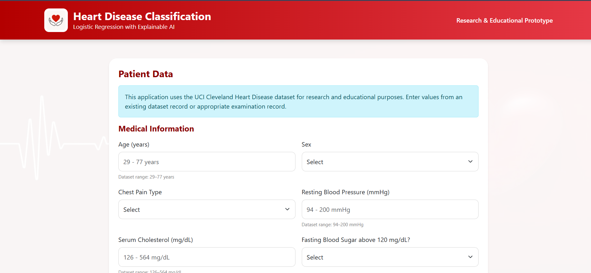
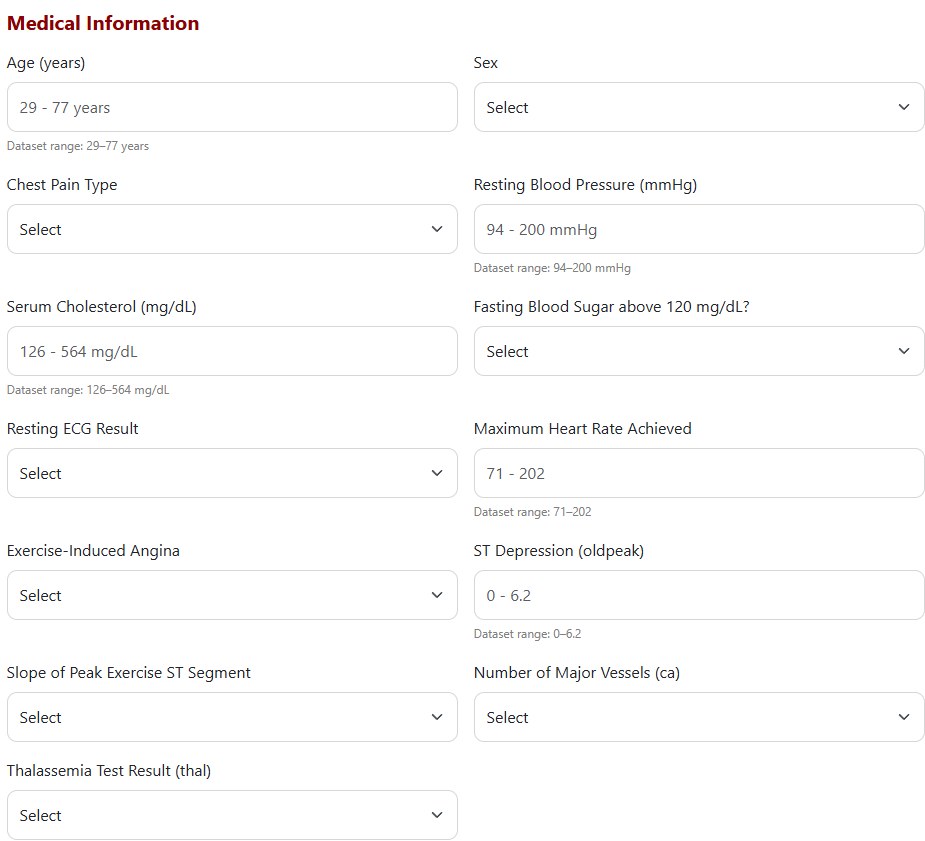
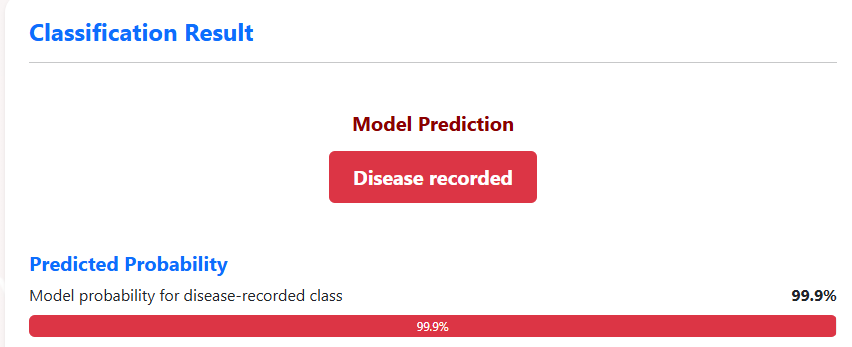
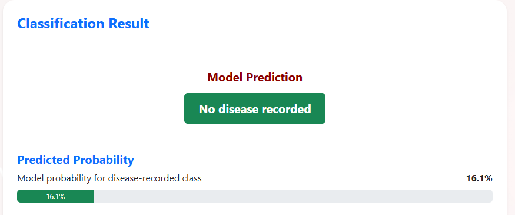
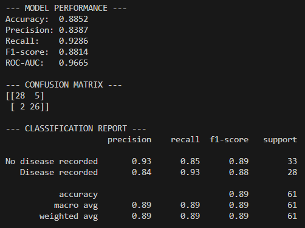
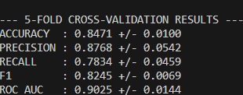
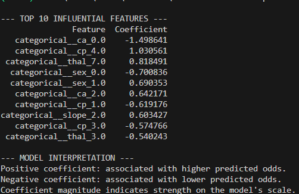

# Explainable Heart Disease Classification Using Logistic Regression

A machine learning project that classifies the presence or absence of recorded heart disease using the UCI Cleveland Heart Disease dataset. The project uses Logistic Regression, a Scikit-learn preprocessing pipeline, model evaluation, and coefficient-based explainability, with a Flask web application for interactive predictions.

## Project Overview

This project investigates binary classification of heart disease using clinical features from the Cleveland subset of the UCI Heart Disease dataset.

The original dataset contains five target values (0–4). These are converted into two classes:

- **0 – No disease recorded:** Original target value is 0.
- **1 – Disease recorded:** Original target value is greater than 0.

The project uses Logistic Regression as its classification algorithm. Numerical and categorical features are processed separately using a Scikit-learn pipeline. Model performance is evaluated using a stratified train-test split and five-fold stratified cross-validation.

A Flask application provides a web interface through which users can enter the 13 input features and view the model's predicted class and positive-class probability.

## Objectives

- Build a reproducible binary classification workflow using the Cleveland dataset.
- Handle missing values in numerical and categorical features.
- Apply appropriate feature scaling and categorical encoding.
- Train and evaluate a Logistic Regression classifier.
- Examine model coefficients to understand feature associations.
- Integrate the trained pipeline into a Flask web application.

## Dataset

**Dataset:** UCI Heart Disease Dataset – Cleveland subset

- Records: 303
- Input features: 13
- Original target classes: 0, 1, 2, 3, 4
- Missing values: 6, found in `ca` and `thal`
- Binary target: 0 (no disease recorded) and 1 (disease recorded)

**Dataset source:** [UCI Machine Learning Repository – Heart Disease](https://archive.ics.uci.edu/dataset/45/heart+disease)

The project uses the processed Cleveland data file, `processed.cleveland.data`.

## Input Features

The model uses the following 13 features:

| Feature | Description |
|---|---|
| age | Age in years |
| sex | Sex category |
| cp | Chest pain type |
| trestbps | Resting blood pressure |
| chol | Serum cholesterol |
| fbs | Fasting blood sugar category |
| restecg | Resting electrocardiographic result |
| thalach | Maximum heart rate achieved |
| exang | Exercise-induced angina |
| oldpeak | ST depression induced by exercise relative to rest |
| slope | Slope of the peak exercise ST segment |
| ca | Number of major vessels |
| thal | Thalassemia-related category |

The categorical feature values follow the coding used in the original dataset.

## Technology Stack

- **Programming language:** Python
- **Data processing:** Pandas, NumPy
- **Machine learning:** Scikit-learn
- **Model persistence:** Joblib
- **Web framework:** Flask
- **Frontend:** HTML, CSS, Bootstrap
- **Development environment:** Visual Studio Code

## Project Structure

```text
heart-disease-risk-predictor/
│
├── app.py
├── model_pipeline.py
├── README.md
├── requirements.txt
├── .gitignore
│
├── data/
│   ├── raw/
│   │   └── processed.cleveland.data
│   └── processed/
│
├── models/
│   └── heart_disease_logistic_regression.joblib
│
├── src/
│   ├── inspect_dataset.py
│   ├── preprocessing.py
│   ├── model_training.py
│   ├── model_evaluation.py
│   └── explainable_ai.py
│
├── templates/
│   ├── index.html
│   └── result.html
│
├── static/
│   ├── style.css
│   └── images/
│
└── docs/
    ├── architecture.md
    ├── model-methodology.md
    ├── dataset-documentation.md
    └── screenshots/
```

## Methodology

### 1. Data Loading and Target Conversion

The Cleveland dataset is loaded using Pandas. Missing values represented by `?` are converted into missing-value entries.

The original target variable `num` is converted into a binary target:

- `num = 0` becomes class 0.
- `num > 0` becomes class 1.

### 2. Data Preprocessing

The input features are divided into numerical and categorical groups.

**Numerical features:**
- Median imputation for missing values.
- StandardScaler for feature standardization.

**Categorical features:**
- Most-frequent-value imputation.
- OneHotEncoder for categorical representation.

A Scikit-learn ColumnTransformer combines both preprocessing pipelines.

### 3. Model Training

Logistic Regression is trained using a complete Scikit-learn Pipeline containing the preprocessing component and classifier.

The dataset is divided into:

- 80% training data.
- 20% testing data.

The split uses `random_state=42` and stratification to preserve class proportions.

### 4. Model Evaluation

The model is evaluated using:

- Accuracy
- Precision
- Recall
- F1-score
- ROC-AUC
- Confusion matrix
- Classification report

Five-fold StratifiedKFold cross-validation is also performed on the training portion of the dataset.

### 5. Explainability

Model coefficients are extracted from the fitted Logistic Regression classifier.

- Positive coefficients indicate an association with higher predicted log-odds of class 1.
- Negative coefficients indicate an association with lower predicted log-odds of class 1.
- Absolute coefficient magnitude is used to rank the transformed features.

These coefficients describe model associations, not causal relationships.

## Experimental Results

### Holdout Test Results

The model was evaluated on 61 records from the 20% test split.

| Metric | Result |
|---|---:|
| Accuracy | 0.8852 |
| Precision | 0.8387 |
| Recall | 0.9286 |
| F1-score | 0.8814 |
| ROC-AUC | 0.9665 |

**Confusion matrix:**

| | Predicted: No disease | Predicted: Disease |
|---|---:|---:|
| Actual: No disease | 28 | 5 |
| Actual: Disease | 2 | 26 |

### Five-Fold Cross-Validation Results

Cross-validation was performed on the training portion of the dataset.

| Metric | Mean | Standard Deviation |
|---|---:|---:|
| Accuracy | 0.8471 | 0.0100 |
| Precision | 0.8768 | 0.0542 |
| Recall | 0.7834 | 0.0459 |
| F1-score | 0.8245 | 0.0069 |
| ROC-AUC | 0.9025 | 0.0144 |

These results are specific to the selected dataset and experimental split. The dataset is relatively small, so the results should be interpreted cautiously.

## Running the Project Locally

### 1. Clone the repository

```bash
git clone https://github.com/antonynithish/heart-disease-risk-predictor.git
cd heart-disease-risk-predictor
```

### 2. Create a virtual environment

On Windows PowerShell:

```powershell
python -m venv .venv
.venv\Scripts\Activate.ps1
```

### 3. Install dependencies

```powershell
pip install -r requirements.txt
```

### 4. Inspect the dataset

```powershell
python src/inspect_dataset.py
```

### 5. Train the model

```powershell
python src/model_training.py
```

The trained pipeline will be saved to:

```text
models/heart_disease_logistic_regression.joblib
```

### 6. Run model evaluation

```powershell
python src/model_evaluation.py
```

### 7. Run model explainability

```powershell
python src/explainable_ai.py
```

### 8. Start the Flask application

```powershell
python app.py
```

Open the following address in your browser:

```text
http://127.0.0.1:5000/
```

The Flask application loads the saved model from the `models/` directory. Therefore, a trained model file must be present before starting the application.

## Documentation

Additional project documentation is available in the `docs/` directory:

- `architecture.md` – System architecture and application workflow.
- `model-methodology.md` – Preprocessing, model training, evaluation, and explainability.
- `dataset-documentation.md` – Dataset source, features, target conversion, and limitations.
- `screenshots/` – Application and experimental screenshots.

## Application Screenshots

### Web Application

**Home Page**



**Input Form**



**Negative Classification Example**



**Positive Classification Example**



### Model Experiments

**Holdout Model Evaluation**



**Five-Fold Cross-Validation**



**Model Explainability**



## Limitations

- The dataset contains only 303 records from the Cleveland subset.
- The dataset represents a historical patient cohort and may not represent other populations.
- The model uses a single classification algorithm.
- The holdout and cross-validation results do not establish clinical validity.
- Model probabilities are not calibrated personal clinical risk estimates.
- Input boundaries in the web application reflect observed dataset ranges, not medically established limits.
- The application is an educational and research prototype, not a medical diagnostic or screening tool.

## Future Improvements

- Evaluate the model using additional independent datasets.
- Investigate probability calibration.
- Improve input validation and application testing.
- Explore additional explainability and model evaluation techniques where justified.

## Author

**Antony Nithish**

GitHub: [antonynithish](https://github.com/antonynithish)
