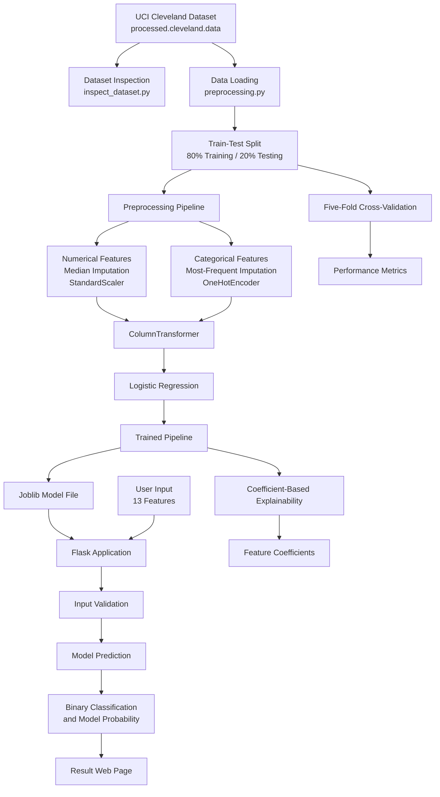
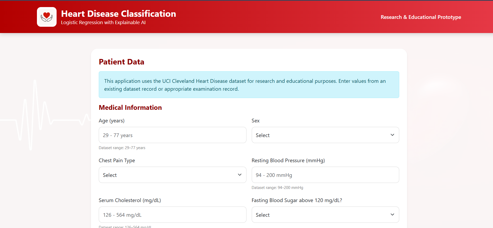
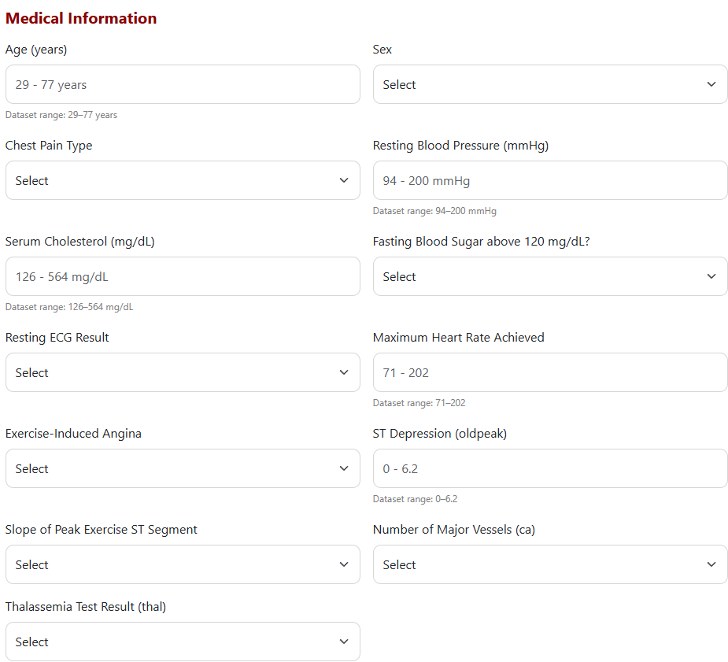
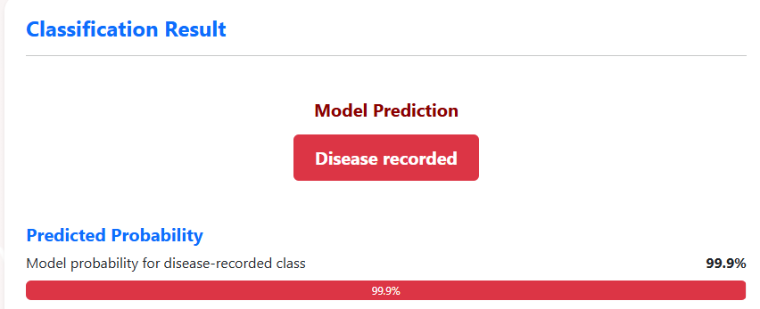
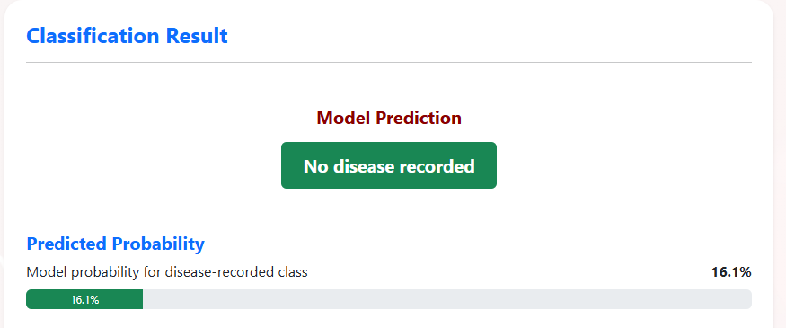

# System Architecture

## 1. Introduction

The Explainable Heart Disease Classification system is a machine-learning-based web application that predicts whether heart disease is recorded or not based on 13 input features.

The system uses the UCI Cleveland Heart Disease dataset, a Scikit-learn preprocessing and classification pipeline, and a Flask web application.

The architecture is divided into four main components:

1. Data management and inspection
2. Machine learning and preprocessing
3. Model evaluation and explainability
4. Web application and prediction interface

## 2. System Architecture Diagram

## 3. Main System Components

### 3.1 Dataset Management

The system uses the processed Cleveland subset of the UCI Heart Disease dataset.

The dataset contains 303 records, 13 input features, and one original target column.

The `src/inspect_dataset.py` module is responsible for examining:

- Dataset dimensions
- Initial records
- Data types
- Missing values
- Original target distribution

### 3.2 Data Preprocessing

The `src/preprocessing.py` module performs dataset loading, target conversion, and preprocessing configuration.

The original target is converted into a binary classification target:

- 0: No disease recorded
- 1: Disease recorded

The preprocessing pipeline uses:

- Median imputation and StandardScaler for numerical features.
- Most-frequent imputation and OneHotEncoder for categorical features.
- ColumnTransformer to combine both transformations.

### 3.3 Model Training

The `src/model_training.py` module trains the Logistic Regression classifier.

The dataset is divided using an 80:20 stratified train-test split with a fixed random state of 42.

A Scikit-learn Pipeline combines the preprocessing component and Logistic Regression classifier.

After training, the complete fitted pipeline is saved using Joblib.

**Saved model:**

`models/heart_disease_logistic_regression.joblib`

### 3.4 Model Evaluation

The `src/model_evaluation.py` module performs five-fold stratified cross-validation on the training portion of the dataset.

The evaluation includes:

- Accuracy
- Precision
- Recall
- F1-score
- ROC-AUC

The training module separately evaluates the held-out test set and prints its confusion matrix and classification report.

### 3.5 Model Explainability

The `src/explainable_ai.py` module extracts the coefficients of the trained Logistic Regression classifier.

Feature names are obtained from the fitted preprocessing component, allowing coefficients to be associated with the transformed feature names.

The module ranks features according to their absolute coefficient magnitude and displays the ten largest.

### 3.6 Web Application

The Flask web application provides an interface for submitting the 13 input features.

The main components are:

| Component | Responsibility |
|---|---|
| `app.py` | Flask routes, form handling, and input validation |
| `model_pipeline.py` | Loads the trained model and generates predictions |
| `templates/index.html` | User input form |
| `templates/result.html` | Displays the prediction result |
| `static/style.css` | Application styling |
| `static/images/` | Interface images |

## 4. Application Workflow

The web application follows this sequence:

1. The user opens the home page.
2. The application displays the input form.
3. The user enters the 13 feature values.
4. Flask receives the submitted form.
5. The application converts the values into their expected numerical types.
6. The application checks numerical ranges and allowed categorical values.
7. The validated input is passed to `predict_heart_disease()` in `model_pipeline.py`.
8. The saved pipeline generates a binary classification and positive-class probability.
9. Flask passes the results to the result template.
10. The browser displays the classification and model probability.

## 5. Model Integration

The trained model is saved as a single Joblib file containing both preprocessing transformations and the Logistic Regression classifier.

When `model_pipeline.py` is imported, it loads the saved pipeline.

The prediction function:

- Arranges the input values in the expected feature order.
- Creates a Pandas DataFrame.
- Generates the predicted binary class.
- Retrieves the probability for class 1.
- Returns the prediction and probability percentage to Flask.

This approach ensures that the same fitted preprocessing operations used during training are applied during prediction.

## 6. Software and Libraries

| Technology | Purpose |
|---|---|
| Python | Main programming language |
| Pandas | Dataset loading and manipulation |
| NumPy | Numerical operations |
| Scikit-learn | Preprocessing, classification, and evaluation |
| Joblib | Saving and loading the trained pipeline |
| Flask | Web application backend |
| HTML | Web page structure |
| CSS | Web page styling |
| Bootstrap | Responsive interface components |

## 7. Project Organization

The project separates source code, datasets, trained models, web templates, static resources, and documentation into dedicated directories.

This organization improves maintainability and makes the development and execution workflow easier to understand.

## 8. Limitations

The system is an educational and research prototype. Its predictions are based on a small historical dataset and should not be interpreted as medical diagnoses or validated clinical risk assessments.

The model probability is an estimate produced by the classifier, not a calibrated personal clinical risk.

## 9. Application Screenshots

The following screenshots demonstrate the web application's interface and prediction workflow.

### Home Page

### Input Form

### Prediction Results

**No Disease Recorded**

**Disease Recorded**

