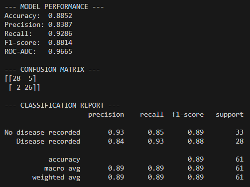
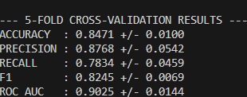
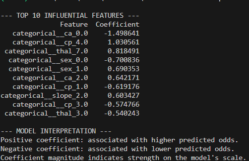

# Model Methodology

## 1. Introduction

This project implements a binary classification approach for identifying the presence or absence of recorded heart disease using the UCI Cleveland Heart Disease dataset.

Logistic Regression is selected as the classification algorithm. The methodology consists of data preparation, preprocessing, model training, performance evaluation, and coefficient-based explainability.

The complete workflow is implemented using Python and Scikit-learn.

## 2. Problem Formulation

The original Cleveland dataset contains a target variable named `num`, with five possible values ranging from 0 to 4.

For this project, the original target is converted into a binary classification problem.

| Original target | Converted target | Class |
|---|---:|---|
| 0 | 0 | No disease recorded |
| 1 | 1 | Disease recorded |
| 2 | 1 | Disease recorded |
| 3 | 1 | Disease recorded |
| 4 | 1 | Disease recorded |

The objective is to classify an input record into one of these two classes using 13 input features.

## 3. Data Preparation

The dataset is loaded using Pandas.

The six missing values represented by `?` are converted into missing-value entries during data loading.

The input variables are separated from the target variable:

- `X`: Contains the 13 input features.
- `y`: Contains the converted binary target.

The input features are divided into two groups.

### 3.1 Numerical Features

The following five features are treated as numerical measurements:

- age
- trestbps
- chol
- thalach
- oldpeak

### 3.2 Categorical Features

The following eight features are treated as categorical or binary variables:

- sex
- cp
- fbs
- restecg
- exang
- slope
- ca
- thal

## 4. Data Preprocessing

A Scikit-learn preprocessing pipeline is constructed using separate transformations for numerical and categorical features.

### 4.1 Numerical Feature Processing

Two operations are applied to numerical features.

**Median Imputation**

The median strategy replaces missing numerical values with the median calculated from the training data.

**Standardization**

StandardScaler transforms numerical features to have approximately zero mean and unit variance.

This helps place numerical measurements with different scales on a comparable scale for Logistic Regression.

### 4.2 Categorical Feature Processing

Two operations are applied to categorical features.

**Most-Frequent Imputation**

Missing categorical values are replaced with the most frequently occurring category in the training data.

**One-Hot Encoding**

OneHotEncoder converts categorical variables into binary indicator features.

The encoder uses `handle_unknown="ignore"` to handle categories that were not observed during fitting.

### 4.3 Combined Preprocessing

ColumnTransformer combines the numerical and categorical preprocessing pipelines.

The preprocessing component is included inside the complete Scikit-learn Pipeline with the classifier.

Consequently, imputation values, scaling parameters, and categorical encodings are learned from the training data rather than the test data. This helps prevent data leakage.

## 5. Dataset Splitting

The dataset is divided into training and testing subsets using `train_test_split`.

| Parameter | Configuration |
|---|---|
| Training proportion | 80% |
| Testing proportion | 20% |
| Random state | 42 |
| Stratification | Enabled |

The resulting split contains:

| Subset | Records |
|---|---:|
| Training | 242 |
| Testing | 61 |
| Total | 303 |

Stratification maintains approximately the same class distribution across the training and testing subsets.

## 6. Classification Algorithm

### Logistic Regression

Logistic Regression is used as the primary classification algorithm.

It is a supervised learning algorithm suitable for binary classification. It estimates the probability of an input belonging to the positive class using a logistic function.

The model is implemented using:

`LogisticRegression(max_iter=1000)`

The maximum iteration limit is set to 1000 to allow the optimization algorithm sufficient iterations to converge.

The classifier produces:

- Predicted class: 0 or 1.
- Estimated probability for class 1.

No additional classification algorithms are included in the current experimental implementation.

## 7. Model Training

The complete Scikit-learn Pipeline consists of:

1. ColumnTransformer for feature preprocessing.
2. Logistic Regression for classification.

The model is fitted using the training subset.

After training, predictions and positive-class probabilities are generated for the held-out test subset.

The complete fitted pipeline is saved using Joblib.

**Model file:**

`models/heart_disease_logistic_regression.joblib`

Saving the complete pipeline ensures that the same fitted preprocessing transformations are reused during prediction.

## 8. Model Evaluation

The model is evaluated using multiple classification metrics.

### 8.1 Accuracy

Measures the proportion of correctly classified records among all evaluated records.

### 8.2 Precision

Measures the proportion of positive predictions that are actually positive.

### 8.3 Recall

Measures the proportion of actual positive records correctly identified by the model.

### 8.4 F1-score

Represents the harmonic mean of precision and recall.

### 8.5 ROC-AUC

Measures the model's ability to distinguish between the two classes across classification thresholds.

### 8.6 Confusion Matrix

The confusion matrix summarizes correct and incorrect predictions for both classes.

## 9. Holdout Test Results

The following results were obtained using the held-out test subset containing 61 records.

| Metric | Result |
|---|---:|
| Accuracy | 0.8852 |
| Precision | 0.8387 |
| Recall | 0.9286 |
| F1-score | 0.8814 |
| ROC-AUC | 0.9665 |

### Confusion Matrix

| Actual / Predicted | No disease recorded | Disease recorded |
|---|---:|---:|
| No disease recorded | 28 | 5 |
| Disease recorded | 2 | 26 |

The model correctly classified 28 records in the negative class and 26 records in the positive class.

## 10. Five-Fold Stratified Cross-Validation

Five-fold stratified cross-validation is performed using the training subset.

The training data is divided into five folds. Each fold is used once for validation while the remaining folds are used for training.

The complete preprocessing and classification pipeline is evaluated within each fold.

The cross-validation configuration uses:

- Number of folds: 5
- Shuffling: Enabled
- Random state: 42

### Cross-Validation Results

| Metric | Mean | Standard Deviation |
|---|---:|---:|
| Accuracy | 0.8471 | 0.0100 |
| Precision | 0.8768 | 0.0542 |
| Recall | 0.7834 | 0.0459 |
| F1-score | 0.8245 | 0.0069 |
| ROC-AUC | 0.9025 | 0.0144 |

The mean and standard deviation summarize the results across the five validation folds.

The held-out test set is not used in this cross-validation process.

## 11. Model Explainability

The project uses Logistic Regression coefficients to examine the influence of transformed features on the model's predictions.

The fitted preprocessing component provides the feature names after scaling and one-hot encoding.

The coefficients are extracted from the trained Logistic Regression classifier.

Features are ranked using the absolute magnitude of their coefficients, and the ten largest are displayed.

### Coefficient Interpretation

- A positive coefficient is associated with higher predicted log-odds of class 1.
- A negative coefficient is associated with lower predicted log-odds of class 1.
- A larger absolute coefficient indicates a stronger association on the model's transformed feature scale.

For numerical features, coefficients relate to standardized values.

For one-hot encoded categorical features, coefficients represent associations relative to the relevant reference category, subject to the encoding scheme.

These coefficients describe associations learned by the model. They do not establish causation or medical importance.

## 12. Prediction Workflow

The trained model is integrated into a Flask application.

The application receives 13 input values from the user and performs input validation.

The values are arranged in the expected feature order and passed to the saved pipeline.

The model returns:

- Binary classification.
- Estimated probability for the positive class.

The application displays these results through the result page.

The probability is a model output and should not be interpreted as a calibrated personal clinical risk.

## 13. Experimental Limitations

- The dataset contains only 303 records.
- The data represents a historical Cleveland patient cohort.
- Performance may vary on other datasets and populations.
- Only one classification algorithm is evaluated.
- The current evaluation does not establish clinical validity.
- Coefficient-based explanations indicate model associations, not causal effects.
- Probability calibration has not been established.

## 14. Summary

The implemented methodology combines numerical and categorical preprocessing with Logistic Regression in a unified Scikit-learn Pipeline.

The model is evaluated using a stratified holdout test set and five-fold stratified cross-validation. Coefficient-based explainability provides insight into the transformed features associated with the model's predictions.

The resulting trained pipeline is integrated into a Flask web application for interactive binary classification.

## 15. Experimental Screenshots

The following screenshots provide visual evidence of the model's experimental outputs.

### Holdout Test Evaluation

### Five-Fold Cross-Validation

### Coefficient-Based Explainability

